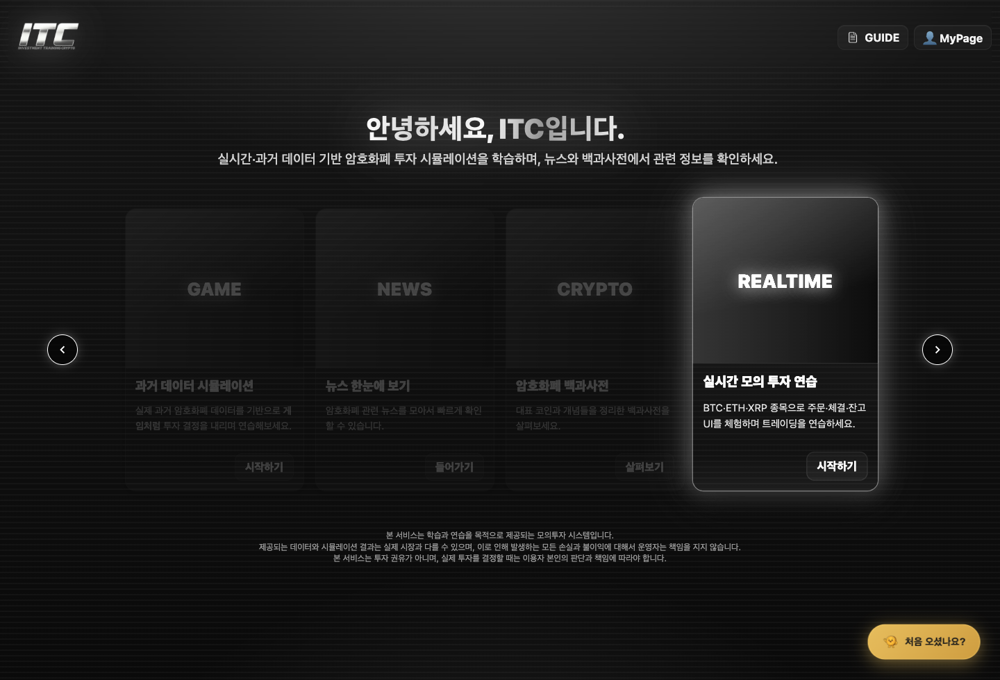
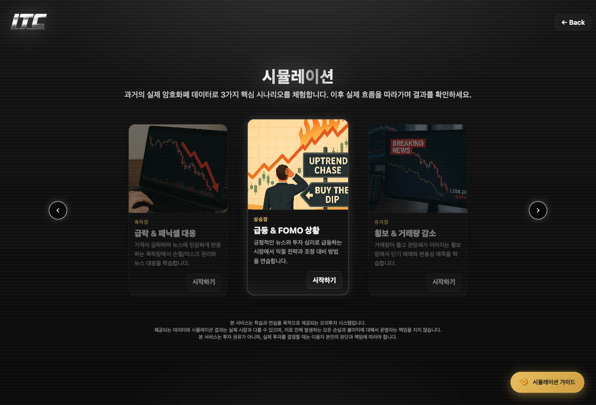
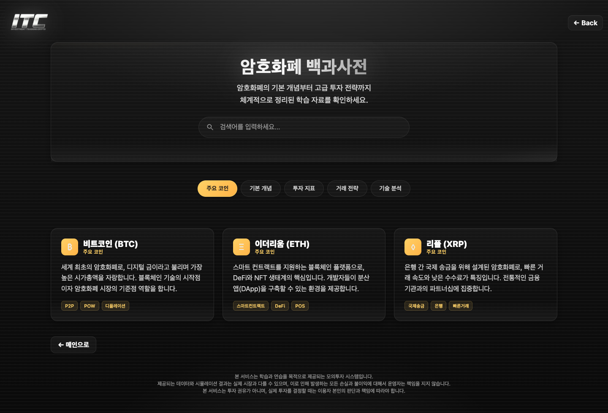
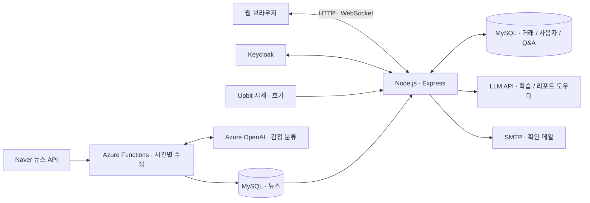

<div align="center">



# ITC · Investment Training Crypto

### 시장을 이해하고, 투자를 연습하고, 나의 판단을 돌아보다.

실제 시장 데이터로 연습하고, 뉴스와 AI로 이해하며,<br />
나의 거래를 리포트로 돌아보는 **암호화폐 투자 학습 플랫폼**입니다.

**2025.08–09 · 6인 팀 프로젝트 · PM & Data Engineer**

[서비스 화면](#서비스-화면) · [주요 기능](#주요-기능) · [시스템 구성](#시스템-구성) · [담당 역할](#담당-역할) · [실행 안내](#실행-안내)

</div>

---

## 프로젝트 소개

암호화폐 투자를 처음 접하면 차트와 용어가 낯설고, 매매 결과만으로는 자신의 판단을 돌아보기 어렵습니다. ITC는 **배우기 → 연습하기 → 돌아보기**를 하나의 서비스 안에 연결했습니다.

| 배우기 | 연습하기 | 돌아보기 |
| :--- | :--- | :--- |
| 백과사전에서 코인·지표·전략 이해 | 실시간 시세와 과거 시나리오로 모의 매매 | 자산 변화와 거래 패턴을 리포트로 확인 |
| 뉴스와 AI 도우미로 시장 맥락 파악 | 주문·체결·취소와 상황별 판단 경험 | 리포트 AI에게 결과를 질문하며 복기 |

## 서비스 화면

### 학습과 투자 연습을 연결하는 홈



<table>
  <tr>
    <th width="50%">서로 다른 시장을 경험하는 시나리오</th>
    <th width="50%">필요한 개념을 찾아보는 백과사전</th>
  </tr>
  <tr>
    <td></td>
    <td></td>
  </tr>
</table>

<sub>공개 소스의 정적 화면을 로컬에서 캡처했습니다. 운영 계정·실시간 데이터·외부 인증 서비스는 연결하지 않았습니다.</sub>

## 주요 기능

### 01 · 실제 시세로 연습하는 모의투자

- **BTC · ETH · XRP** 원화 시장의 실시간 시세·호가·캔들 확인
- 시장가·지정가 주문, 대기 주문 취소, 부분 체결과 보유자산 평가
- 이동평균선·RSI·MACD·볼린저 밴드를 활용한 차트 탐색
- 시세·기술지표·뉴스 감정 정보를 참고하는 **AI 시장 도우미**

### 02 · 과거 시장에서 판단하는 시나리오

| 시나리오 | 연습하는 판단 |
| :--- | :--- |
| 급락 & 패닉셀 대응 | 가격 급락과 불안한 시장에서 매수·매도·유지 판단 |
| 급등 & FOMO 상황 | 빠른 상승장에서 추격 매수와 진입 시점 검토 |
| 횡보 & 거래량 감소 | 방향성이 약한 시장에서 기다림과 대응 전략 검토 |

과거 가격 데이터와 **학습용으로 구성한 뉴스 타임라인**을 함께 제공합니다. 재생·일시정지·속도 조절·초기화를 통해 자신의 속도로 연습할 수 있습니다.

### 03 · 뉴스와 개념을 연결하는 학습

- Naver 뉴스 검색 API로 **매시간 뉴스 수집**
- Azure OpenAI로 긍정·중립·부정 감정을 분류하고 중복 기사 제거
- 키워드·기간·감정별 뉴스 탐색
- 주요 코인, 블록체인·지갑·채굴, 투자 지표·전략을 다루는 **검색형 백과사전**
- 화면별 단계 안내와 Q&A·댓글·비공개 질문

### 04 · 거래 결과를 해석하는 개인 리포트

- 최근 **15일 자산·수익률 변화**와 월간 거래 현황
- FIFO 기준 실현손익, 종목별 거래 비중, 최근 거래 활동
- 전체 사용자 평균 수익률과 나의 결과 비교
- 리포트 데이터를 읽는 **AI 질의응답**과 브라우저 인쇄·PDF 저장

## 시스템 구성



뉴스 감정 분석과 대화형 AI 도우미는 각각 별도 파이프라인과 API 설정을 사용합니다. 웹 서버의 진입점은 **`server.js`**입니다.

### 기술 스택

| 영역 | 기술 |
| :--- | :--- |
| 웹 화면 | HTML · CSS · JavaScript · Lightweight Charts · Chart.js |
| 서버·실시간 처리 | Node.js · Express · WebSocket |
| 데이터·인증 | MySQL · Keycloak · express-session |
| 뉴스·AI | Python · Azure Functions · Azure OpenAI · Naver Search API |
| 배포 구성 | Docker · Kubernetes · Skaffold · Azure DevOps |
| 별도 운영 분석 | Azure SQL · Microsoft Fabric · Lakehouse · Power BI |

## 담당 역할

**PM & Data Engineer**로서 학습 경험을 설계하고, 서비스 운영을 이해하는 분석 흐름을 구성했습니다.

| 영역 | 직접 맡은 작업 |
| :--- | :--- |
| 프로젝트 관리 | 로드맵·리스크 관리, 기능 진행 조율과 통합 이슈 정리 |
| 시나리오 설계 | 세 가지 과거 시장 시나리오의 학습 조건·진행 방식 설계 및 관리 |
| 학습 콘텐츠 | 백과사전 프로토타입, 암호화폐 개념과 RSI·MACD·볼린저 밴드 설명 제작 |
| 데이터 파이프라인 | Azure SQL → Fabric Dataflow → Lakehouse → 분석용 Fact Table 구성 |
| 운영 분석 | 고객 특성·선호 코인·주문 방식·거래량 분석, 1시간 단위 갱신 Power BI 대시보드 |

웹 서비스·거래 엔진·인증·AI·인프라는 팀원들과 함께 통합한 공동 산출물입니다. 위 운영 분석 내용은 프로젝트 수행 기록을 기준으로 정리했으며, **Fabric·Power BI의 전체 구성은 이 저장소에 포함되어 있지 않습니다.**

## 저장소 둘러보기

```text
.
├── server.js                    # 웹 서버 · 인증 · API 통합
├── public/
│   ├── index.html               # 홈 · 온보딩
│   ├── realtime.html            # 실시간 모의투자
│   ├── historical.html          # 과거 시나리오 선택
│   ├── scenarios/               # 시나리오별 학습 화면
│   ├── crypto.html              # 암호화폐 백과사전
│   ├── news.html                # 뉴스 탐색
│   ├── report.html              # 개인 투자 리포트
│   ├── mypage.html              # 사용자 정보 · 자산
│   ├── qna.html                 # 질문과 답변
│   ├── js/                     # 브라우저 코드 + 서버 등록 모듈
│   └── css/ · images/ · voice/  # 스타일 · 이미지 · 음성 리소스
├── services/                    # DB · 인증 · 이메일 · 자산 서비스
├── trading/                     # 주문 처리 · 매칭 · WebSocket
├── azure_function_app.py        # 뉴스 수집 · 감정 분석 · 적재
├── Dockerfile                   # Node.js 20 컨테이너
├── k8s/                         # Kubernetes 매니페스트
├── azure-pipelines.yml          # Azure DevOps 배포 예시
└── docs/                        # 배포 안내 · 화면 이미지
```

<details>
<summary><strong>코드를 읽을 때 참고할 점</strong></summary>

- `public/js/`에는 브라우저 코드 외에 `server.js`에서 불러오는 뉴스·리포트·Q&A·시나리오·실시간 서버 모듈도 들어 있습니다.
- 주문·체결 흐름은 [`trading/services/`](trading/services/)와 [`trading/managers/`](trading/managers/)에서 확인할 수 있습니다.
- [`trading/js/app.js`](trading/js/app.js)는 별도 진입 구현이며 `npm start`의 실행 경로에는 포함되지 않습니다.
- 루트 [`config.js`](config.js)는 Azure Key Vault 연동 모듈입니다. 기본 `server.js`에서 직접 불러오지는 않습니다.

</details>

## 실행 안내

이 저장소는 팀 프로젝트의 공개 소스 스냅샷입니다. **DB 스키마·가격 데이터·인증 및 외부 API 설정을 별도로 준비해야 합니다.**

### 1. 소스와 의존성 준비

Node.js **20** 환경을 기준으로 합니다.

```bash
git clone https://github.com/wwiskey/ITC.git
cd ITC
npm ci
cp .env.example .env
```

### 2. 외부 서비스 설정

[`.env.example`](.env.example)을 참고해 사용하는 서비스의 값을 `.env`에 입력합니다.

| 설정 | 준비할 내용 |
| :--- | :--- |
| `DB_*` · `TRADING_DB_NAME` · `QNA_DB_NAME` · `KEYCLOAK_DB_NAME` | 사용자·거래·질문·인증 데이터베이스와 스키마 |
| `KEYCLOAK_*` · `SESSION_SECRET` | 로그인 환경과 충분히 긴 임의 세션 키 |
| `AZURE_MYSQL_*` | 뉴스 API가 읽을 MySQL 데이터베이스 |
| `LLM_API_ENDPOINT` · `LLM_API_KEY` | 대화형 AI 도우미 API |
| `SMTP_*` · `PUBLIC_BASE_URL` | 확인 메일과 본인 서비스의 기본 URL |

```bash
npm start
```

기본 포트는 `3000`입니다. 환경과 데이터를 준비한 뒤 [localhost:3000](http://localhost:3000)에서 확인합니다.

<details>
<summary><strong>Python 뉴스 수집과 배포 설정</strong></summary>

- 뉴스 수집은 웹 서버와 별도로 실행하는 Azure Functions 코드입니다.
- `azure-functions`, `requests`, `mysql-connector-python`, `openai` 등 Python 의존성과 Functions 프로젝트 구성을 준비해야 합니다. 현재 저장소에는 `requirements.txt`와 `host.json`이 없습니다.
- `NAVER_*` · `AZURE_OPENAI_*`를 설정하고, Python의 `DB_*`와 웹 서버의 `AZURE_MYSQL_*`가 같은 뉴스 DB를 바라보도록 맞춥니다.
- Azure Key Vault 모듈을 사용할 때는 `AZURE_KEY_VAULT_NAME`, Azure 자격 증명, 해당 SDK 의존성을 별도로 준비합니다.
- 컨테이너·클라우드 배포는 [Azure 배포 설정 안내](docs/AZURE_DEPLOYMENT.md)를 참고하세요. 파이프라인의 리소스명은 예시값이며 자동 실행은 꺼져 있습니다.

</details>

<details>
<summary><strong>현재 소스의 범위와 확인 사항</strong></summary>

- DB 초기화 SQL과 외부 클라우드 리소스 전체는 포함되어 있지 않습니다.
- `npm test`는 기본 명령만 있는 상태로, 자동 테스트가 구현되어 있지 않습니다.
- 모의 체결은 학습용 구현이며 실제 거래소의 체결·수수료·슬리피지를 동일하게 재현하지 않습니다.
- 시나리오 뉴스는 학습용 콘텐츠입니다. 실제 뉴스 수집 기능과 구분됩니다.
- 일부 튜토리얼에서 참조하는 음성 파일은 포함되어 있지 않습니다.
- 원본 Git 이력·가상환경·환경변수 파일은 공개 대상에서 제외했습니다. 실제 인증정보는 `.env` 등 별도 환경에서 관리합니다.

</details>

---

<div align="center">

**Learn the market. Practice your decisions. Reflect on your trades.**

<sub>학습을 위한 모의투자 프로젝트 · 팀 공동 산출물 · 별도의 오픈소스 라이선스를 부여하지 않습니다.</sub>

</div>
